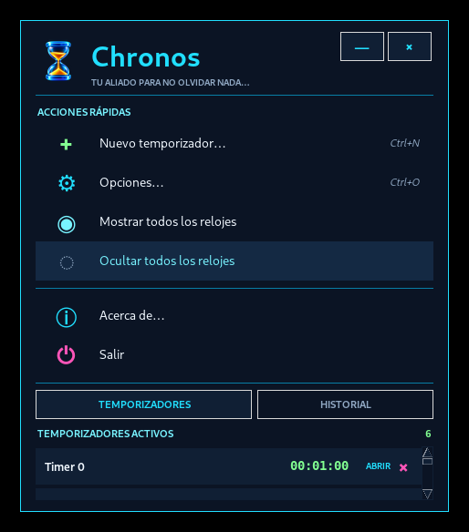
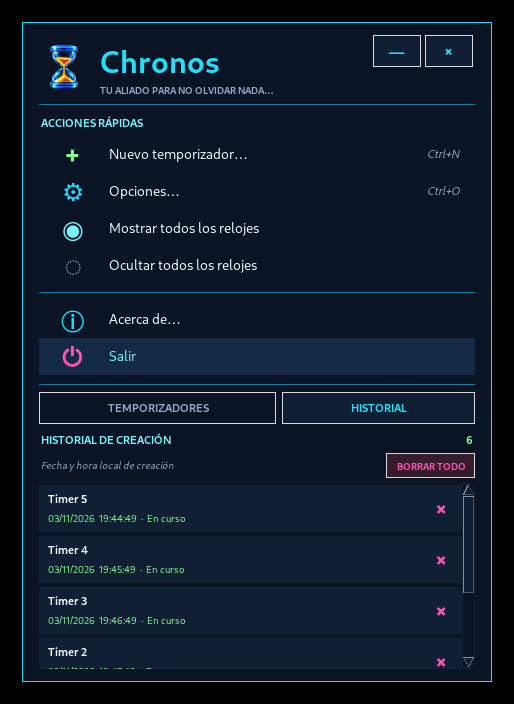
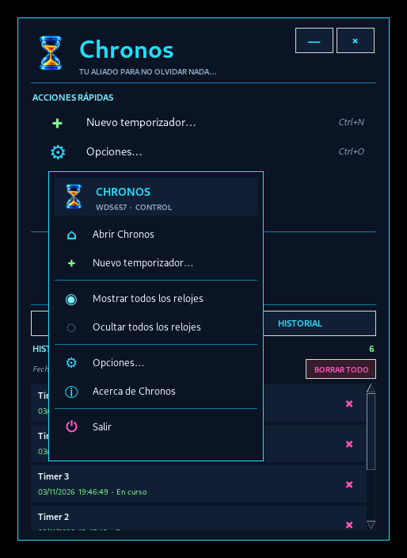
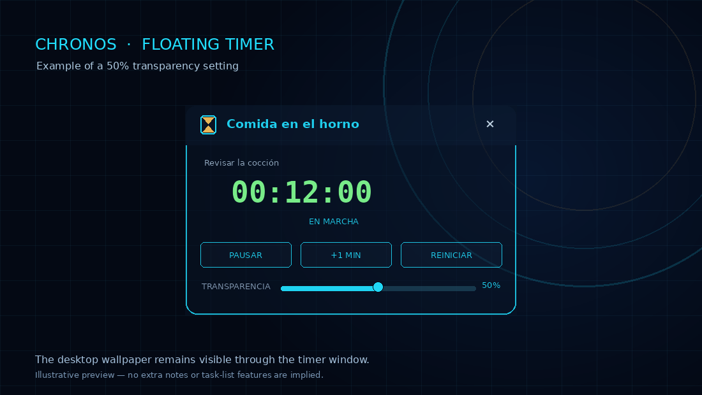

<div align="center">
  
  <h1>Chronos</h1>
  <p><strong>Temporizadores flotantes para Windows 10 y Windows 11.</strong></p>
  <p>Mantené varias cuentas regresivas visibles sobre tus aplicaciones, identificá cada reloj con un título y recibí una alarma sonora al terminar.</p>
  <p><strong>Versión base: 1.0</strong> · <a href="README.md">Read this in English</a></p>
  <p>
    
    
    
    
  </p>
</div>

## Descripción

Chronos es una utilidad liviana de escritorio para Windows que permite crear varios temporizadores con nombre al mismo tiempo. Cada reloj tiene su propia ventana pequeña, movible y siempre visible, para controlar la cocina, tareas de trabajo, pruebas de equipos, descansos, recordatorios de medicación o cualquier actividad que no quieras olvidar.

La interfaz utiliza un tema azul marino oscuro, bordes cian neón, contadores verdes y un icono de reloj de arena de cristal azul con arena dorada.

**Chronos 1.0 es la primera versión pública y la base oficial del proyecto.** Reúne el conjunto completo de funciones en un punto de partida para el desarrollo futuro. Las próximas versiones y los forks derivados de este lanzamiento deberían identificar Chronos 1.0 como versión de origen y conservar la atribución original a WDS657.

## Vistas de la interfaz

> Estas imágenes son vistas previas de la interfaz del proyecto. El aspecto puede variar ligeramente según la versión de Windows, la escala de pantalla y las fuentes disponibles.

### Ventana principal



### Historial de temporizadores



### Menú personalizado de la bandeja



### Temporizador flotante con 50% de transparencia



> Imagen ilustrativa de la interfaz: muestra el reloj al 50% de opacidad sobre otra ventana del escritorio.

## Funciones

- **Múltiples temporizadores:** creá todos los relojes que necesites, cada uno con título y nota.
- **Ventanas siempre visibles:** mantené los relojes por encima de otras aplicaciones.
- **Modo compacto:** doble clic en la barra superior para plegar el reloj en una tira estrecha; repetí el doble clic para desplegarlo.
- **Temporizadores redimensionables:** ajustá cada ventana por separado. El contenido se escala al reducir el ancho o el alto.
- **Transparencia ajustable:** cada reloj tiene su propio ajuste de transparencia. Se incluye un ejemplo visual al 50%.
- **Interfaz bilingüe:** elegí español o inglés desde **Opciones**. La selección se guarda localmente y se recupera en el próximo inicio.
- **Alarma:** al llegar a `00:00`, se repite un sonido WAV hasta confirmar. Incluye un control para probar el sonido.
- **Aviso visual:** el reloj parpadea al llegar a cero y vuelve a mostrarse si estaba oculto.
- **Controles:** pausar, reanudar, reiniciar, agregar un minuto y eliminar un temporizador.
- **Historial persistente:** registra fecha y hora de creación, título, nota, duración y estado. Se pueden borrar entradas individuales o todo el historial.
- **Bandeja del sistema de Windows:** utiliza un icono nativo del área de notificación y un menú contextual propio con el tema oscuro/neón de Chronos.
- **Temporizadores independientes:** ocultar o minimizar el panel principal no oculta los relojes activos; siguen funcionando mientras Chronos permanezca en la bandeja.
- **Instancia única:** si Chronos ya está abierto, un segundo inicio activa la instancia existente en vez de crear otra.
- **Datos locales:** configuración, temporizadores, historial y registros se guardan en la carpeta de datos del usuario de Windows.

## Primeros pasos

### Opción A — Ejecutar desde el código fuente

**Requisitos**

- Windows 10 o Windows 11.
- Python 3.10 o posterior, instalado con soporte Tcl/Tk (el instalador estándar de python.org lo incluye).
- Acceso a Internet para instalar la dependencia por primera vez, si Pillow todavía no está instalado.

1. Cloná el repositorio:

   ```powershell
   git clone https://github.com/hydraroot/Chronos.git
   cd Chronos
   ```

2. Ejecutá el lanzador:

   ```powershell
   .\run.bat
   ```

   `run.bat` comprueba los requisitos de Python/Tkinter/Pillow, instala las dependencias si hace falta e inicia Chronos.

También podés instalar la dependencia manualmente y ejecutar el código:

```powershell
py -3 -m pip install --user -r requirements.txt
py -3 chronos.py
```

### Opción B — Generar el ejecutable de Windows

1. Abrí la carpeta del proyecto en Windows.
2. Ejecutá `build_exe.bat`.
3. El script instala PyInstaller para el usuario actual y genera la aplicación en:

   ```text
   dist\Chronos\Chronos.exe
   ```

**Importante:** Chronos se empaqueta en modo `onedir` de PyInstaller. Conservá junta toda la carpeta `dist\Chronos`, incluida `_internal` y los demás archivos generados. No muevas `Chronos.exe` fuera de esa carpeta. La aplicación no necesita permisos de administrador.

Para diagnosticar errores de inicio, ejecutá `build_exe_debug.bat`. Para abrir el registro de la aplicación, ejecutá `ver_registro.bat`.

## Uso básico

1. Elegí **Nuevo temporizador** en la ventana principal o en el menú de la bandeja.
2. Ingresá un título, una nota opcional y la duración.
3. Mové el reloj flotante arrastrando su barra superior.
4. Hacé doble clic en la barra superior para plegarlo o desplegarlo.
5. Usá los controles para pausar, reanudar, reiniciar o agregar un minuto.
6. Ajustá la transparencia desde los controles de ese reloj.
7. Cuando llegue a cero, confirmá la alarma repetitiva con **OK**.
8. Abrí **Opciones** desde la ventana principal o el menú de bandeja, elegí **ESPAÑOL** o **ENGLISH** y presioná **APLICAR IDIOMA**. La interfaz principal y los relojes abiertos se actualizan sin reiniciar las cuentas regresivas.

Al cerrar el panel principal con su botón de cierre, Chronos se oculta en la bandeja del sistema; no sale de la aplicación. Elegí **Salir** en el menú de la bandeja para cerrar Chronos y todos sus temporizadores.

## Datos locales y registros

Chronos guarda los datos del usuario en:

```text
%APPDATA%\Chronos\
```

| Archivo | Función |
|---|---|
| `timers.json` | Estado de los temporizadores activos y ajustes individuales de ventanas. |
| `history.json` | Historial persistente de creación y estado de cada temporizador. |
| `settings.json` | Idioma guardado de la interfaz (`es` o `en`). |
| `chronos_alarm.wav` | Sonido de alarma generado localmente. |
| `chronos.log` | Mensajes de inicio, bandeja del sistema y diagnóstico. |

Chronos no necesita una cuenta en línea ni servicios en la nube. Solo se requiere conexión para instalar paquetes de Python o herramientas de compilación cuando todavía no están disponibles.

## Autoría y atribución

**Creador original del proyecto y responsable de mantenimiento: WDS657**  
El concepto del proyecto, la dirección del producto, el diseño de interfaz, los requisitos funcionales, la validación y el mantenimiento están a cargo de WDS657. La implementación se desarrolló con asistencia de herramientas de IA.

Repositorio oficial: <https://github.com/hydraroot/Chronos>  
Versión base: **Chronos 1.0**

Si publicás, compartís o redistribuís un fork o una versión modificada que contenga material de este proyecto, conservá los archivos `LICENSE` y `NOTICE` y la atribución a **WDS657**, según exige Apache 2.0. Indicá qué archivos modificaste. Podés agregar tu propia atribución por tus aportes, pero no eliminar la atribución original. Consultá [LICENSE](LICENSE) y [NOTICE](NOTICE).

## Uso libre y gratuito

Chronos es software libre y de código abierto bajo la **Apache License 2.0**. Podés usarlo, estudiarlo, modificarlo y redistribuirlo **sin pagar una licencia ni regalías a WDS657**. Esto se aplica al uso personal, educativo, institucional y también comercial. La licencia no prohíbe el uso comercial: permite utilizar el software sin regalías, siempre que se respeten las condiciones de atribución, avisos y redistribución.

Quien redistribuya el proyecto original o una versión derivada debe incluir la licencia Apache 2.0, conservar los avisos de copyright y atribución aplicables (incluidos los de `NOTICE`) e identificar los archivos modificados. La licencia también permite que terceros cobren por copias, soporte o garantías bajo sus términos; el simple uso de Chronos no genera un pago a WDS657. Leé [LICENSE](LICENSE) para conocer las condiciones legales completas.

Los componentes de terceros mantienen sus propias licencias. Pillow se instala como dependencia y este proyecto no cambia su licencia.

## Política de firma de código

**Estado actual:** Chronos 1.0 todavía no fue aceptado en el programa de SignPath Foundation. El primer ZIP público para Windows no está firmado; ninguna descarga actual se presenta como firmada. El proyecto planea solicitar **firma gratuita provista por SignPath.io, con certificado de SignPath Foundation**, sujeto a la aprobación. Consultá [CODE_SIGNING_POLICY.md](CODE_SIGNING_POLICY.md) para ver el estado, los roles del equipo, los controles de publicación y el plan de firma. Hasta obtener la aprobación y completar una solicitud de firma, descargá únicamente desde el repositorio oficial y considerá el ejecutable como no firmado.

## Política de privacidad

Chronos funciona localmente y no envía títulos, notas, historial ni ajustes a servicios remotos. Consultá [PRIVACY.md](PRIVACY.md) para conocer el almacenamiento de datos, el comportamiento de red y las instrucciones de desinstalación.

## Contribuciones

Se aceptan reportes de errores, sugerencias y pull requests. Incluí la versión de Windows, la versión de Python (si ejecutás desde el código), los pasos para reproducir el problema y los mensajes relevantes del registro. Los cambios derivados de este lanzamiento deben identificar Chronos 1.0 como versión base. Consultá [CONTRIBUTING.md](CONTRIBUTING.md).
