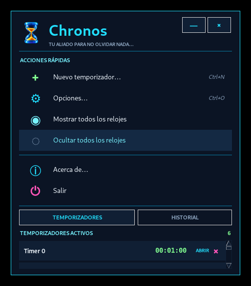
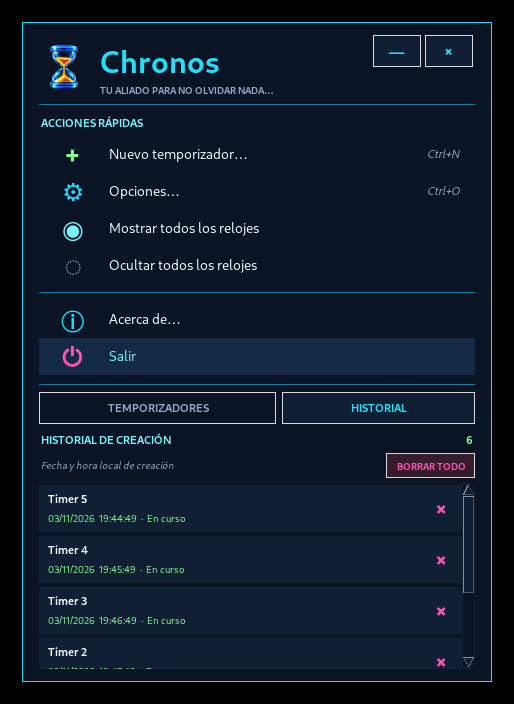
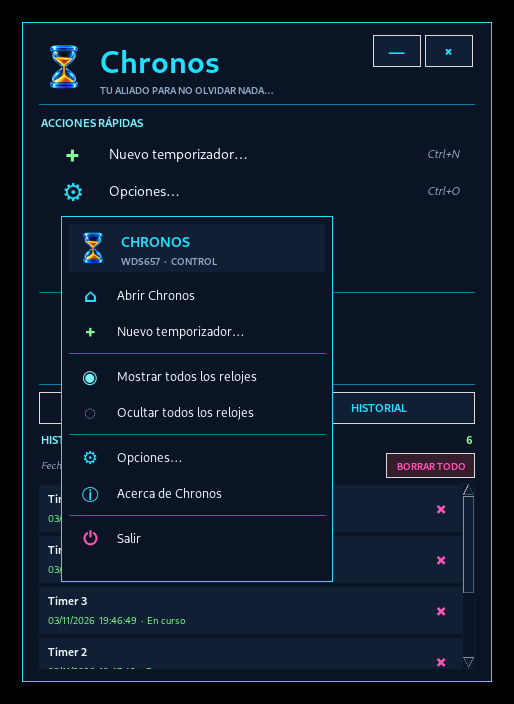
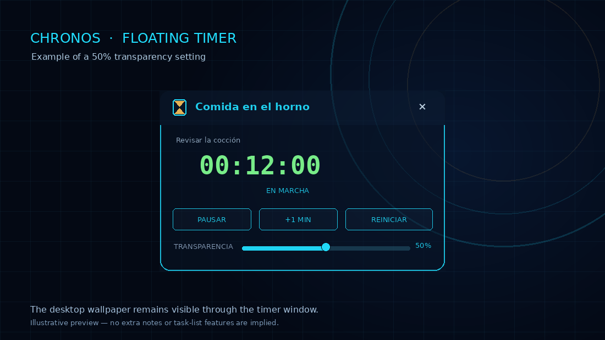

<div align="center">
  
  <h1>Chronos</h1>
  <p><strong>A floating multi-timer for Windows 10 and Windows 11.</strong></p>
  <p>Keep multiple countdowns visible above your apps, label every timer, and get an audible alert when time is up.</p>
  <p><strong>Baseline release: 1.0</strong> · <a href="README.es.md">Leer en español</a></p>
  <p>
    
    
    
    
  </p>
</div>

## Overview

Chronos is a lightweight Windows desktop utility for creating several named countdown timers at the same time. Each timer has its own small, movable, always-on-top window, so you can keep an eye on cooking, work sessions, equipment tests, breaks, medication reminders, or any task that should not be forgotten.

The interface uses a dark navy theme with cyan neon accents, green digital counters, and a blue-glass hourglass icon with golden sand.

**Chronos 1.0 is the project's first public baseline release.** It consolidates the complete feature set into a stable starting point for future development. Future versions and forks derived from this release should identify Chronos 1.0 as their starting baseline and retain the original attribution to WDS657.

## Interface previews

> These images are interface previews from the project. Appearance may vary slightly with Windows version, display scaling, and font availability.

### Main window



### Timer history



### Custom system-tray menu



### Floating timer at 50% transparency



> Transparency image: illustrative interface preview showing the timer window at 50% opacity over another desktop window.

## Features

- **Multiple countdown timers:** create as many timers as needed, each with a title and note.
- **Always-on-top windows:** keep timers visible over other applications.
- **Compact mode:** double-click a timer's title bar to collapse it into a narrow pill; double-click again to restore it.
- **Resizable timers:** resize each timer independently. The interface scales as the window becomes narrower or shorter.
- **Adjustable transparency:** set transparency individually for each timer, from opaque to the supported transparency range. A 50% transparency example is shown above.
- **Bilingual interface:** choose Spanish or English in **Settings**. The selection is saved locally and restored on the next launch.
- **Alarm:** a WAV sound repeats when the countdown reaches `00:00` until it is acknowledged. A sound-test control is included.
- **Visual alert:** the timer flashes when it reaches zero and reappears if it had been hidden.
- **Timer controls:** pause, resume, reset, add one minute, and delete a timer.
- **Persistent history:** records the creation date/time, title, note, duration, and status of each timer. Entries can be deleted individually or cleared together.
- **Windows system tray:** uses a native Windows notification-area icon and a Chronos-styled dark/neon context menu.
- **Independent timer windows:** hiding or minimizing the main panel does not hide active timers; timers keep running while Chronos remains in the tray.
- **Single instance:** launching Chronos again activates the existing instance instead of opening another one.
- **Local storage:** settings, timers, history, and logs are stored in the current Windows user's application-data folder.

## Getting started

### Option A — Run from source

**Requirements**

- Windows 10 or Windows 11.
- Python 3.10 or newer, installed with Tcl/Tk support (the standard python.org installer includes it).
- Internet access for the first dependency installation, if Pillow is not already installed.

1. Clone the repository:

   ```powershell
   git clone https://github.com/hydraroot/Chronos.git
   cd Chronos
   ```

2. Run the launcher:

   ```powershell
   .\run.bat
   ```

   `run.bat` checks the Python/Tkinter/Pillow prerequisites, installs the requirements when needed, and starts Chronos.

You can also install the dependency manually and launch the source:

```powershell
py -3 -m pip install --user -r requirements.txt
py -3 chronos.py
```

### Option B — Build the Windows executable

1. Open the project folder in Windows.
2. Run `build_exe.bat`.
3. The build script installs PyInstaller for the current user and creates the application in:

   ```text
   dist\Chronos\Chronos.exe
   ```

**Important:** Chronos is packaged in PyInstaller `onedir` mode. Keep the complete `dist\Chronos` folder together, including `_internal` and the other generated files. Do not move `Chronos.exe` out of that folder. The application does not require administrator privileges.

For startup diagnostics, run `build_exe_debug.bat`. To open the application log, run `ver_registro.bat`.

## Basic usage

1. Choose **New timer** in the main window or the system-tray menu.
2. Enter a title, an optional note, and the countdown duration.
3. Move the floating timer by dragging its top bar.
4. Double-click the top bar to collapse or expand the timer.
5. Use the timer controls to pause, resume, reset, or add one minute.
6. Adjust transparency from that timer's own control.
7. When the timer reaches zero, acknowledge the repeating alarm with **OK**.
8. Open **Settings** from the main window or tray menu, choose **SPANISH** or **ENGLISH**, and select **APPLY LANGUAGE**. The dashboard and open timer windows are refreshed without resetting their countdowns.

Closing the main panel with its close button hides Chronos in the system tray; it does not exit the application. Choose **Exit** from the tray menu to close Chronos and all its timers.

## Local data and logs

Chronos stores user data in:

```text
%APPDATA%\Chronos\
```

| File | Purpose |
|---|---|
| `timers.json` | Active timer state and individual window settings. |
| `history.json` | Persistent timer creation history and status. |
| `settings.json` | Saved interface language (`es` or `en`). |
| `chronos_alarm.wav` | Locally generated alarm sound. |
| `chronos.log` | Startup, tray, and diagnostic messages. |

Chronos does not need an online account or a cloud service to run. Network access is only needed to install Python packages or build tools when they are not already available.

## Project authorship and attribution

**Original project creator and maintainer: WDS657**  
Project concept, product direction, interface design, feature requirements, validation, and maintenance are led by WDS657. The implementation was developed with AI-assisted coding.

Official repository: <https://github.com/hydraroot/Chronos>  
Baseline release: **Chronos 1.0**

If you publish, share, or redistribute a fork or modified version containing material from this project, retain the `LICENSE` and `NOTICE` files and the attribution to **WDS657** as required by Apache License 2.0. Mark modified files as changed. You may add your own attribution for your contributions, but do not remove the original attribution. See [LICENSE](LICENSE) and [NOTICE](NOTICE).

## Free use and license

Chronos is free and open-source software under the **Apache License 2.0**. You may use, study, modify, and redistribute it **without paying a license fee or royalty to WDS657**. This applies to personal, educational, organizational, and commercial use. The license does not prohibit commercial use; it makes use of the software royalty-free while requiring compliance with its attribution, notice, and redistribution conditions.

Anyone redistributing the original project or a derivative must provide the Apache 2.0 license, preserve applicable copyright and attribution notices (including the notices in `NOTICE`), and mark modified files as changed. The license also permits redistributors to charge for copies, support, or warranties under its terms; no such payment is owed to WDS657 merely for using Chronos. Read [LICENSE](LICENSE) for the complete legal terms.

Third-party components remain under their respective licenses. Pillow is installed as a dependency and is not re-licensed by this project.

## Code signing policy

**Current status:** Chronos 1.0 has not yet been accepted into the SignPath Foundation program. The first public Windows ZIP is unsigned; no current download is represented as signed. The project intends to apply for **Free code signing provided by SignPath.io, certificate by SignPath Foundation**, subject to acceptance. See [CODE_SIGNING_POLICY.md](CODE_SIGNING_POLICY.md) for the current status, team roles, release controls, and signing plan. Until approval and a successful signing request, download only from the official repository and treat the binary as unsigned.

## Privacy policy

Chronos runs locally and does not send timer data, notes, history, or settings to a remote service. See [PRIVACY.md](PRIVACY.md) for data storage, network behavior, and uninstall instructions.

## Contributing

Bug reports, suggestions, and pull requests are welcome. Please describe the Windows version, Python version (if running from source), steps to reproduce, and relevant log messages. All changes should identify Chronos 1.0 as the baseline when derived from this release. See [CONTRIBUTING.md](CONTRIBUTING.md).
